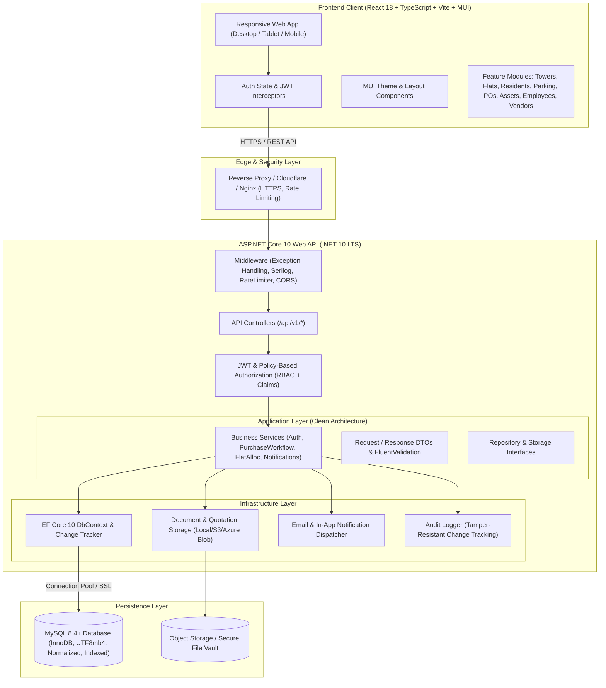

# Apartment Maintenance Management System: Architecture & Design Specification

This document provides the foundational engineering blueprint for the Apartment Maintenance Management System, designed to scale for 5,000+ registered residents, committee members, employees, and vendors.

---

## 1. System Architecture Diagram



---

## 2. Entity Relationship Diagram (ERD)

```mermaid
erDiagram
    USERS ||--o{ REFRESH_TOKENS : "has"
    USERS ||--o{ USER_ROLES : "assigned"
    ROLES ||--o{ USER_ROLES : "belongs_to"
    ROLES ||--o{ ROLE_PERMISSIONS : "contains"
    PERMISSIONS ||--o{ ROLE_PERMISSIONS : "referenced_in"
    USERS ||--o{ AUDIT_LOGS : "triggers"
    USERS ||--o{ NOTIFICATIONS : "receives"

    TOWERS ||--o{ FLATS : "contains"
    TOWERS ||--o{ PARKING_LOTS : "houses"
    FLATS ||--o{ FLAT_OWNERSHIPS : "owned_by"
    FLATS ||--o{ FLAT_OCCUPANCIES : "occupied_by"
    FLATS ||--o{ PARKING_ALLOCATIONS : "allocated"
    PARKING_LOTS ||--o{ PARKING_ALLOCATIONS : "allocated_to"
    RESIDENTS ||--o{ FLAT_OWNERSHIPS : "holds"
    RESIDENTS ||--o{ FLAT_OCCUPANCIES : "resides_in"
    USERS ||--o| RESIDENTS : "links_to_account"
    USERS ||--o| EMPLOYEES : "links_to_account"

    VENDOR_CATEGORIES ||--o{ VENDORS : "classifies"
    VENDORS ||--o{ VENDOR_CONTRACTS : "holds"
    VENDORS ||--o{ ASSETS : "maintains"
    VENDORS ||--o{ PURCHASE_REQUESTS : "quoted_for"
    VENDORS ||--o{ PURCHASE_ORDERS : "fulfilled_by"

    ASSET_CATEGORIES ||--o{ ASSETS : "classifies"
    TOWERS ||--o{ ASSETS : "locates"
    ASSETS ||--o{ ASSET_MAINTENANCE_RECORDS : "tracks"
    ASSETS ||--o{ PURCHASE_REQUEST_ITEMS : "referenced_in"

    USERS ||--o{ COMMITTEE_MEMBERS : "acts_as"
    USERS ||--o{ PURCHASE_REQUESTS : "creates"
    PURCHASE_REQUESTS ||--o{ PURCHASE_REQUEST_ITEMS : "includes"
    PURCHASE_REQUESTS ||--o{ PURCHASE_REQUEST_ATTACHMENTS : "supported_by"
    PURCHASE_REQUESTS ||--o{ PURCHASE_APPROVALS : "evaluated_by"
    PURCHASE_REQUESTS ||--o| PURCHASE_ORDERS : "generates"
    PURCHASE_ORDERS ||--o{ PURCHASE_ORDER_ITEMS : "contains"

    USERS {
        uuid Id PK
        string Email UK
        string PasswordHash
        string FirstName
        string LastName
        string PhoneNumber
        boolean IsActive
        datetime CreatedAtUtc
        datetime UpdatedAtUtc
    }

    ROLES {
        int Id PK
        string Name UK
        string NormalizedName
        string Description
    }

    TOWERS {
        int Id PK
        string TowerCode UK
        string TowerName
        int NumberOfFloors
        int TotalFlats
        string Description
        boolean IsActive
    }

    FLATS {
        int Id PK
        int TowerId FK
        string FlatNumber
        int FloorNumber
        decimal AreaSqFt
        string AreaMeasurementType
        string OwnershipStatus
        string OccupancyStatus
        boolean IsActive
    }

    PARKING_LOTS {
        int Id PK
        string LotNumber UK
        int TowerId FK
        string ParkingType
        string FloorOrBasementLevel
        string Status
        boolean IsActive
    }

    PARKING_ALLOCATIONS {
        int Id PK
        int ParkingLotId FK
        int FlatId FK
        int ResidentId FK
        datetime StartDateUtc
        datetime EndDateUtc
        boolean IsActive
    }

    PURCHASE_REQUESTS {
        uuid Id PK
        string RequestNumber UK
        string Title
        string Description
        uuid RequesterId FK
        int VendorId FK
        decimal TotalEstimatedAmount
        string BudgetCategory
        string CurrentStatus
        int CurrentStepOrder
        byte[] RowVersion
        datetime CreatedAtUtc
    }

    PURCHASE_APPROVALS {
        int Id PK
        uuid PurchaseRequestId FK
        uuid ApproverId FK
        string ApproverRole
        int StepOrder
        string Decision
        string Comments
        datetime DecisionDateUtc
    }

    PURCHASE_ORDERS {
        uuid Id PK
        string PoNumber UK
        uuid PurchaseRequestId FK
        int VendorId FK
        decimal TotalAmount
        string DeliveryStatus
        datetime OrderDateUtc
    }
```



---

## 3. Entity Relationships and Data Integrity Rules

1. **User Identity & Multi-tenancy of Personas:**
   - A single `User` record manages authentication (JWT credentials, password salt/hash, refresh tokens).
   - An authorized user may be linked to an `Employee` record, a `Resident` record, or a `CommitteeMember` term without schema duplication.
2. **Flats & Towers:**
   - Composite unique constraint: `[TowerId, FlatNumber]` ensures no duplicate flats within a tower.
   - Deleting a Tower is restricted if flats exist (`DeleteBehavior.Restrict`).
3. **Flat Ownership & Occupancy Separation:**
   - `FlatOwnerships` captures one or multiple co-owners per flat, with ownership percentage and start/end dates.
   - `FlatOccupancies` captures tenants/occupants independently from ownership.
4. **Car Parking Allocation Invariant:**
   - Unique active constraint on `ParkingLotId` where `IsActive = true`, preventing double allocation.
   - History is preserved when an allocation is released (`IsActive = false`, `EndDateUtc = UtcNow`).
5. **Purchase Order Approval Sequential Invariant:**
   - Configured order: Step 1 = President, Step 2 = Secretary, Step 3 = Treasurer.
   - A purchase request holds an optimistic concurrency token (`RowVersion` / `ConcurrencyStamp`) to prevent race conditions during simultaneous committee actions.
   - Approver cannot approve a request they authored unless committee emergency override policy is enabled.
6. **Audit Logs:**
   - Insert-only table recording `EntityName`, `EntityId`, `Action` (Create, Update, Delete, Approve, Reject), `OldValues`, `NewValues`, `UserId`, `IpAddress`, `TimestampUtc`.

---

## 4. API Endpoint Plan

### 4.1 Authentication & Security (`/api/v1/auth`)
- `POST /api/v1/auth/login` - Authenticate user, return JWT Access Token and set secure HttpOnly refresh token cookie.
- `POST /api/v1/auth/refresh-token` - Issue fresh access token using valid refresh token.
- `POST /api/v1/auth/logout` - Revoke current refresh token and clear cookie.
- `GET  /api/v1/auth/me` - Get profile, active roles, committee status, and permissions.
- `POST /api/v1/auth/change-password` - Update password with validation.

### 4.2 User & Role Administration (`/api/v1/users`, `/api/v1/roles`)
- `GET    /api/v1/users` - Paginated user list with role filters and search.
- `POST   /api/v1/users` - Create user and assign initial roles.
- `GET    /api/v1/users/{id}` - Get user details.
- `PUT    /api/v1/users/{id}` - Update user status, phone, profile.
- `PUT    /api/v1/users/{id}/roles` - Reassign user roles.
- `GET    /api/v1/roles` - List system roles and permission sets.

### 4.3 Tower & Flat Management (`/api/v1/towers`, `/api/v1/flats`)
- `GET    /api/v1/towers` - List all towers with flat count summary.
- `POST   /api/v1/towers` - Create new tower.
- `PUT    /api/v1/towers/{id}` - Update tower details.
- `GET    /api/v1/flats` - Paginated flat search (filter by tower, occupancy, ownership).
- `POST   /api/v1/flats` - Register new flat with carpet/super built-up area.
- `GET    /api/v1/flats/{id}` - Full details including owners, occupants, and assigned parking.
- `PUT    /api/v1/flats/{id}` - Update flat specs.

### 4.4 Residents & Owners (`/api/v1/residents`)
- `GET    /api/v1/residents` - Paginated directory of owners and tenants.
- `POST   /api/v1/residents` - Add resident.
- `POST   /api/v1/residents/ownership` - Assign owner to flat (with co-owner %).
- `POST   /api/v1/residents/occupancy` - Assign tenant / resident to flat.
- `DELETE /api/v1/residents/occupancy/{id}` - End tenancy / mark vacated.

### 4.5 Parking Management (`/api/v1/parking`)
- `GET    /api/v1/parking/lots` - All parking lots with tower, type, and allocation status.
- `POST   /api/v1/parking/lots` - Add parking lot.
- `POST   /api/v1/parking/allocate` - Assign parking space to flat & resident.
- `POST   /api/v1/parking/release/{allocationId}` - Release parking space back to pool.
- `GET    /api/v1/parking/history` - Historical parking allocations.

### 4.6 Employee Management (`/api/v1/employees`)
- `GET    /api/v1/employees` - Searchable, sortable, paginated employee table.
- `POST   /api/v1/employees` - Register employee with emergency contact and department.
- `GET    /api/v1/employees/{id}` - View employee (compensation masked unless authorized).
- `PUT    /api/v1/employees/{id}` - Update details.
- `PATCH  /api/v1/employees/{id}/status` - Activate / Deactivate employee.

### 4.7 Vendor Management (`/api/v1/vendors`)
- `GET    /api/v1/vendors` - Paginated vendor directory by category (Security, Lift, etc.).
- `POST   /api/v1/vendors` - Add vendor profile and tax/payment terms.
- `GET    /api/v1/vendors/{id}` - Detailed vendor view with contracts and linked assets.
- `POST   /api/v1/vendors/{id}/contracts` - Add vendor contract with renewal alerts.
- `GET    /api/v1/vendors/categories` - List and manage vendor categories.

### 4.8 Asset Management (`/api/v1/assets`)
- `GET    /api/v1/assets` - Inventory list with warranty status, next maintenance date.
- `POST   /api/v1/assets` - Register asset (generator, lift, pump, fire system).
- `GET    /api/v1/assets/{id}` - Detailed view with maintenance history.
- `POST   /api/v1/assets/{id}/maintenance` - Record maintenance inspection or repair.

### 4.9 Purchase Requests & Sequential Committee Approvals (`/api/v1/purchase-requests`, `/api/v1/purchase-orders`)
- `GET    /api/v1/purchase-requests` - List purchase requests.
- `POST   /api/v1/purchase-requests` - Create draft / submit request.
- `GET    /api/v1/purchase-requests/{id}` - Request details, items, attachments, approval audit trail.
- `POST   /api/v1/purchase-requests/{id}/approve` - Approver action: Approve, Reject, or Return with comments.
- `GET    /api/v1/purchase-requests/my-pending-approvals` - Tailored queue for President, Secretary, or Treasurer.
- `POST   /api/v1/purchase-requests/{id}/generate-po` - Generate Purchase Order from approved request.
- `GET    /api/v1/purchase-orders` - List purchase orders and delivery statuses.

### 4.10 Committee Members (`/api/v1/committee`)
- `GET    /api/v1/committee` - Active and past committee members.
- `POST   /api/v1/committee/assign` - Assign user to President, Secretary, or Treasurer role with term dates.

### 4.11 Dashboard, Reports & Audit (`/api/v1/dashboard`, `/api/v1/audit-logs`)
- `GET    /api/v1/dashboard/metrics` - Real-time counts (flats, occupied %, parking available, pending POs, assets due).
- `GET    /api/v1/audit-logs` - Filterable audit trail for administrators.

---

## 5. Solution Structure

```
d:\AppartmentApps\
├── ApartmentMaintenance.sln
├── src/
│   ├── ApartmentMaintenance.Domain/
│   │   ├── Common/               # BaseEntity, AuditableEntity, ISoftDeletable
│   │   ├── Entities/             # User, Role, Tower, Flat, Resident, Parking, Asset, Vendor, Purchase*
│   │   └── Enums/                # UserRoles, PurchaseStatus, ApprovalDecision, ParkingType, etc.
│   │
│   ├── ApartmentMaintenance.Application/
│   │   ├── Common/               # PagedResult, Result, CurrentUserService interface
│   │   ├── DTOs/                 # Auth, Towers, Flats, Parking, PO, Vendor, Employee DTOs
│   │   ├── Interfaces/           # IApplicationDbContext, IJwtTokenService, IEmailService
│   │   └── Validators/           # FluentValidators for incoming requests
│   │
│   ├── ApartmentMaintenance.Infrastructure/
│   │   ├── Persistence/          # ApplicationDbContext, Configurations, Migrations
│   │   ├── Services/             # JwtTokenService, PasswordHasher, AuditLogService, EmailService
│   │   └── Seed/                 # DatabaseInitializer & MasterDataSeeder
│   │
│   └── ApartmentMaintenance.Api/
│       ├── Controllers/          # Auth, Towers, Flats, Parking, Vendors, Assets, Purchase, Dashboard
│       ├── Middleware/           # GlobalExceptionMiddleware, SerilogConfig
│       ├── Program.cs            # DI Container, JWT auth, Swagger, MySQL EF configuration
│       └── appsettings.json      # Connection strings, JWT settings, CORS
│
├── client/                       # React 18 + TypeScript + Vite + MUI
│   ├── src/
│   │   ├── api/                  # Axios instance, interceptors, typed endpoints
│   │   ├── components/           # Navbar, Sidebar, DataTable, StatCard, ConfirmationModal
│   │   ├── context/              # AuthContext, NotificationContext
│   │   ├── pages/                # Login, Dashboard, Towers, Flats, Parking, Vendors, Purchase, etc.
│   │   ├── theme/                # MUI Theme palette and typography
│   │   ├── types/                # TypeScript models matching backend DTOs
│   │   └── App.tsx               # Router & Role-based routes
│   ├── package.json
│   └── vite.config.ts
│
├── tests/
│   ├── ApartmentMaintenance.UnitTests/
│   └── ApartmentMaintenance.IntegrationTests/
│
├── docker-compose.yml
└── README.md
```
